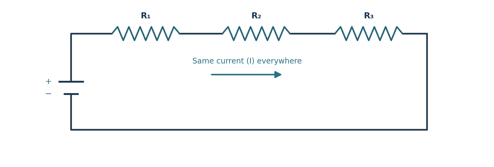
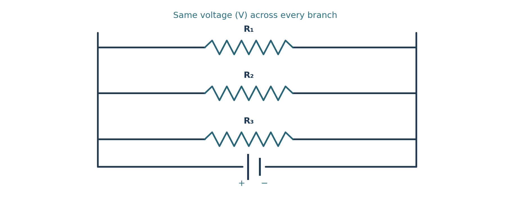

# Electricity

**RAD145 Physics Journal | Revised Study Edition**

Purpose: a complete, concise, instructor-outline-ordered reference journal. A much shorter memorization and active-recall study guide will be created separately.

Authority: 02 Electricity(1).docx (required outline); Electricity Lectures 1, 2, and 3 (103 instructor slides). All source references use L1, L2, and L3 for those lectures. The original handwritten journal remains unchanged.

Notation: I = current (amperes, A); V = potential difference (volts, V); R = resistance (ohms, Ω); P = power (watts, W). Where a worked example is not in the slides, it is labeled “constructed example.”

# A. Electrostatics

## 1. Definitions

**a) Electrostatics:** The branch of physics dealing with stationary (resting) electric charges. Like charges repel; opposite charges attract.

*Instructor slides: L1: 4, 6–7*

**b) Electrification:** Adding electrons to or removing electrons from an object creates an imbalance of charge. The slides distinguish electrification of an object from ionization of an atom.

*Instructor slides: L1: 5*

**(1) Methods of electrification and description of each:** The three methods are friction, contact, and induction. Static discharge belongs with contact electrification in the instructor outline.

*Instructor slides: L1: 14–19*

**Friction:** Rubbing different objects transfers electrons. Example: rubbing a balloon on a wool sweater; dry, cold conditions can make charge buildup more noticeable.

*Instructor slides: L1: 15*

**Contact:** Two objects touch and electrons transfer between them. Example: touching a doorknob after walking across carpet.

*Instructor slides: L1: 16*

**Static discharge (contact method):** Excess charge rapidly moves to reduce a charge difference, sometimes as a visible spark. A spark can jump a small air gap, so physical touching is not always required. The slides mention “tree branch” artifacts.

*Instructor slides: L1: 17–18*

**Induction:** An electric field causes charges to separate or rearrange without the charged object touching the other object. With appropriate grounding, the object can acquire a net charge. Important to electronic devices.

*Instructor slides: L1: 19–21*

**c) Zero/Electric Ground:** Earth is the standard zero (ground) electrical potential reference. Connecting a charged body to Earth through a conductor can let excess charge flow and neutralize the body.

*Instructor slides: L2: 13*

## 2. 5 Laws of Electrostatics

**a) State each law:** 1. Law of Attraction and Repulsion; 2. Inverse Square Law; 3. Law of Distribution; 4. Law of Concentration; 5. Law of Electron Movement.

*Instructor slides: L1: 6–13, 24*

**b) Describe each law:** Each law is explained below in the same order, with a numerical calculation for the second law.

**1. Law of Attraction and Repulsion:** Opposite charges (+ and −) attract; like charges (+/+ or −/−) repel.

*Instructor slides: L1: 7*

**2. Inverse Square Law (Coulomb’s Law):** The electric force between two point charges is proportional to the product of their charges and inversely proportional to the square of their separation. Doubling the distance reduces the force to one-fourth.

*Instructor slides: L1: 8–9*

**F = k|q₁q₂| / r²     |     F₂ = F₁ × (r₁ / r₂)²  (charges fixed)**

Numbers example (corrected interpretation of L1 slide 9): At 4 mm, suppose relative force/field strength = 4 units. At 8 mm (twice as far), strength = 4 × (4/8)² = 1 unit. Distance doubled, strength fell to one-quarter. The slide labels this as “charge”; the charges themselves do NOT become smaller merely because distance increases.

**3. Law of Distribution:** Excess charge on a conductor at electrostatic equilibrium resides on its outer surface. In insulators, charge is less free to move and may remain distributed where placed.

*Instructor slides: L1: 10*

**4. Law of Concentration:** Surface charge tends to be concentrated at sharp points or regions of tight curvature on conductors. X-ray tubes use smooth, rounded surfaces to help limit unwanted discharge.

*Instructor slides: L1: 11–12*

**5. Law of Electron Movement:** In ordinary solid metallic conductors, mobile negative electrons carry the current; the positive ions of the metal lattice stay in place. This is the classroom wording of the law.

*Instructor slides: L1: 13*

# B. Electrodynamics

## 1. Definitions

**a) Electrodynamics:** Branch of physics that studies moving electric charges. In the slides, this is contrasted with electrostatics (resting charges).

*Instructor slides: L1: 4, 26–27*

**b) Electric current:** Directed flow of electric charge; in metallic wires, this flow comes from moving electrons.

*Instructor slides: L1: 28; L2: 5–6*

**c) Vacuum:** A space from which air has been removed, leaving very few particles to interfere with electron motion. A vacuum is used in the X-ray tube.

*Instructor slides: L1: 30*

**d) Conductor (w/example):** Material that lets electrons move easily. Examples: copper and aluminum. For ordinary metal conductors, short, thick, cool wires offer less resistance than long, thin, hot ones.

*Instructor slides: L1: 31, 33–38*

**e) Insulator (w/example):** Material that resists the movement of electrons. Examples: rubber, plastic, and glass.

*Instructor slides: L1: 39–41*

**f) Semiconductor (w/example):** Material that can conduct under some conditions and resist current under others. Instructor examples: silicon and germanium (often associated in class with ±4 valence).

*Instructor slides: L1: 42–43*

**g) Electrical circuit:** A complete conducting pathway from the electrical source, through a load or other devices, and back to the source. A break in the path stops current in that path.

*Instructor slides: L2: 2; L3: 3*

## 2. Describing current flow

**a) Conventional flow vs. electron flow:** These are opposite directions in a metal circuit: conventional current is defined from positive (+) to negative (−); actual electron drift is from negative (−) to positive (+). Conventional notation predates electron discovery.

*Instructor slides: L2: 3–4*

**Conventional current: + → −     |     Electron flow: − → +**

**b) Current (description, unit and symbol used in formulas):** Amount of charge flowing per second; formula symbol I; unit ampere (A). One ampere means one coulomb of charge passes a point each second. The ammeter connects in series. In radiography, current and exposure time combine as mAs.

*Instructor slides: L2: 5–7*

**I = Q / t       |       1 A = 1 C/s       |       1 C ≈ 6.24 × 10¹⁸ electron charges**

**c) Potential difference (description, unit and symbol used in formulas):** Voltage is the electrical potential difference that drives charge through a circuit. The slides also call the source’s driving voltage electromotive force (EMF). Symbol V; unit volt (V). A voltmeter is connected in parallel.

*Instructor slides: L2: 8–10*

**1 V = 1 J/C       |       1 kV = 1,000 V**

**d) Resistance (description, unit and symbol used in formulas):** Opposition to current flow. Symbol R; unit ohm (Ω). In typical metal wires resistance depends on material, length, diameter/cross-sectional area, and temperature.

*Instructor slides: L1: 33–36; L2: 11*

For a typical metal: longer → more resistance; smaller diameter → more resistance; higher temperature → usually more resistance. Material also affects conductivity.

**(1) Conductance vs Admittance:** Conductance (G) describes ease of current flow in a resistive/DC circuit; G = 1/R. Admittance (Y) describes ease of AC flow; Y = 1/Z, where Z is impedance (the total AC opposition). Both use the siemens (S). In the slide’s simple purely resistive circuit, the numerical reciprocal 1/R applies to either.

*Instructor slides: L3: 7, 16–18*

**Conductance: G = 1/R       |       Admittance: Y = 1/Z       |       Unit: S**

**(2) Relationship between valency energy band and conduction band:** Valence band = electron energy states involved in bonding; conduction band = states that permit electrons to carry current. In conductors the bands overlap or conducting states are available; in insulators there is a large separation; in semiconductors there is a smaller separation that electrons may cross under suitable conditions. These band distinctions clarify the lecture’s conductivity examples.

*Instructor slides: L1: 33, 38, 41–43*

| Material | Energy-band relationship | Instructor examples |
| --- | --- | --- |
| Conductor | Overlap / readily available conducting states | Copper, aluminum |
| Insulator | Valence and conduction bands separated | Rubber, plastic, glass |
| Semiconductor | Smaller energy gap; properties can change | Silicon, germanium |

**e) Alternating Current (AC) and Direct Current (DC):** AC reverses direction repeatedly (U.S. household supply is typically 60 Hz). DC flows in one direction (battery example). AC/DC specifies how current direction behaves; it is not the meaning of voltage.

*Instructor slides: L2: 5, 12; L1: 26*

**f) Power (description, unit and symbol used in formulas):** Rate at which electrical energy is transferred or work is done. Symbol P; unit watt (W). One watt is one joule per second, or one volt times one ampere.

*Instructor slides: L2: 24–25*

**P = I × V       |       W = A × V       |       1 kW = 1,000 W**

**g) Formulas and math examples with numbers:** Use consistent units (V, A, Ω, W). Convert mA to A and kV to V before solving. Example: 300 mA = 0.300 A; 30 kV = 30,000 V.

*Instructor slides: L2: 15–16, 22, 25–29*

**(1) Ohm’s Law (3 examples, with V, I and R as x):** Ohm’s Law connects voltage, current, and resistance. All three rearrangements are required.

*Instructor slides: L2: 16–22*

**V = I × R       |       I = V / R       |       R = V / I**

| Find (x) | Known | Solution |
| --- | --- | --- |
| V | I = 50 A; R = 10 Ω | V = 50 × 10 = 500 V  (L2: 18) |
| I | V = 30 V; R = 20 Ω | I = 30 / 20 = 1.50 A  (L2: 20) |
| R | V = 30 V; I = 300 A | R = 30 / 300 = 0.10 Ω  (L2: 17) |

Instructor unit-conversion example (L2: 22): R = 30,000 V / 0.300 A = 100,000 Ω, or 100 kΩ.

**(2) Power Law (3 examples with P, I and V as x):** The Power Law relates electrical power, current, and voltage. The P example follows the slides; I and V examples are constructed to complete all three unknowns required by the outline.

*Instructor slides: L2: 25–28*

**P = I × V       |       I = P / V       |       V = P / I**

| Find (x) | Known | Solution |
| --- | --- | --- |
| P | I = 500 mA = 0.5 A; V = 120 kV = 120,000 V | P = 0.5 × 120,000 = 60,000 W = 60 kW  (L2: 27) |
| I | P = 1,200 W; V = 120 V | I = 1,200 / 120 = 10 A  (constructed example) |
| V | P = 240 W; I = 2 A | V = 240 / 2 = 120 V  (constructed example) |

**(3) Power Loss (2 examples with P and I as x):** When electric current flows through resistance, power is converted to heat (I²R loss). Solve for P or I as required. The I example is constructed.

*Instructor slides: L2: 29, 35*

**P(loss) = I² × R       |       I = √(P(loss) / R)**

| Find (x) | Known | Solution |
| --- | --- | --- |
| P | I = 7 A; R = 3 Ω | P(loss) = 7² × 3 = 147 W  (based on L2: 35) |
| I | P(loss) = 200 W; R = 8 Ω | I = √(200 / 8) = √25 = 5 A  (constructed example) |

# C. Series and Parallel Circuits

## 1. Series Circuit

**a) Drawing:** A series circuit contains one continuous path through all resistances. The source and three resistors are shown below.

*Instructor slides: L3: 3, 6–7*

*Series circuit (original schematic): one path, three resistors*

**b) Description:** Current has only one path. If any series component opens, current stops through the entire path. Resistances add; the same current passes every component.

*Instructor slides: L3: 6–7*

**c) Effect of Series Circuit on Current, Potential and Resistance (math examples with numbers of each):** Current (I) stays equal through each resistor; total potential (V) equals the sum of the drops; total resistance (R) equals the sum of the resistances. The course memory aid is PEPSi (Plus–Equals–Plus = Series).

*Instructor slides: L3: 7, 9, 12, 14*

| Quantity | Series relationship | Course example |
| --- | --- | --- |
| Current | Iₜ = I₁ = I₂ = I₃ | 23 series resistors, each 12 A → total current = 12 A  (L3: 9) |
| Potential / Voltage | Vₜ = V₁ + V₂ + V₃ | 5 V + 2 V + 9 V = 16 V  (L3: 12) |
| Resistance | Rₜ = R₁ + R₂ + R₃ | 1.8 Ω + 5.7 Ω + 3.2 Ω = 10.7 Ω  (L3: 14) |

Important condition: For a fixed supply voltage, adding series resistance lowers total current (I = V/R). The lecture’s statement that total voltage “increases” applies only when discussing a greater sum of individual voltage drops or when a source can supply greater total voltage—not an unchanged battery.

## 2. Parallel Circuit

**a) Drawing:** A parallel circuit provides two or more branches between the same pair of electrical points. The source and three branches are shown below.

*Instructor slides: L3: 3–4, 7*

*Parallel circuit (original schematic): three branches share voltage*

**b) Description:** Current divides among branches. Each branch receives the same applied voltage. Adding a parallel branch lowers total equivalent resistance and (for a fixed voltage source) raises total current.

*Instructor slides: L3: 4, 7*

**c) Effect of Parallel Circuit on Current, Potential and Resistance (math examples with numbers of each):** Total current is the sum of branch currents; total voltage equals the voltage across each branch; equivalent resistance is calculated from reciprocals. The course memory aid is EPI Pen (Equals–Plus–Inverse = Parallel).

*Instructor slides: L3: 7–8, 13, 16–18*

**Iₜ = I₁ + I₂ + I₃       |       Vₜ = V₁ = V₂ = V₃       |       1/Rₜ = 1/R₁ + 1/R₂ + 1/R₃**

| Quantity | Parallel relationship | Course example |
| --- | --- | --- |
| Current | Add branch currents | 4 branches × 8 A = 32 A  (L3: 8) |
| Potential / Voltage | Same voltage in all branches | 3 branches at 3.1259 V → Vₜ = 3.1259 V (≈ 3.13 V)  (L3: 13) |
| Resistance | Add reciprocals, then take reciprocal | 4 Ω, 2 Ω, 3 Ω, 6 Ω: 1/Rₜ = 1/4 + 1/2 + 1/3 + 1/6 = 1.25 S; Rₜ = 1/1.25 = 0.80 Ω  (L3: 17) |

Don’t stop at siemens (S) if the question asks for resistance in ohms (Ω). First add the reciprocals, then invert the result to obtain Rₜ.

## 3. Definitions

**a) Circuit Breaker:** Resettable overcurrent protection device. It automatically opens the circuit when excessive current is detected, helping prevent damaged wiring and fire. Unlike a fuse, it can normally be reset after the cause is corrected.

*Instructor slides: L3: 5 and speaker notes*

**b) Fuse:** A one-time overcurrent protection device with a metal element that melts when excessive current produces heat, opening the circuit. A blown fuse must be replaced.

*Instructor slides: L3: 5 and speaker notes*

**c) Variable resistor/Rheostat:** A resistor whose resistance can be adjusted to control current in a circuit. Increasing resistance tends to reduce current when applied voltage is fixed. This item is required by the outline but is not defined in the three lecture slide decks.

*Source: Outline C.3(c); brief standard explanation (not directly in lecture slides)*

# Course accuracy notes and source coverage

These notes distinguish corrections or brief standard clarifications from the instructor’s slide wording; they are not additional journal requirements.

**Inverse-square example:** L1 slide 9 calls the changing numerical value “charge.” Moving two charges farther apart changes the force/field strength, not the charge on either object.

**Law of Electron Movement:** L1 slide 13 states only negative charges move in solid conductors. This describes metallic conduction; it is not a universal statement about all electrical media.

**Series circuit potential:** L3 slide 6 suggests adding resistances increases total voltage. With a fixed-voltage source, the source voltage remains fixed while current decreases; the sum of voltage drops equals the source voltage.

**Conductance and admittance:** L3 slide 7 presents reciprocal resistance in siemens for conductance or admittance in its simple resistive example. Generally AC admittance is the reciprocal of impedance, not resistance alone.

**Parallel-circuit calculation precision:** Some lecture examples round each reciprocal before the final calculation. Retaining extra decimal places until the end gives more accurate answers (e.g., L3 slide 16 is about 0.9583 Ω, which rounds to 0.96 Ω rather than 0.95 Ω).

**Electrical current terminology:** Current I measures charge per unit time, not simply a static “number of electrons.” AC and DC describe direction over time; voltage is potential difference.

**Valence/conduction bands:** L1 discusses valence and conduction bands but does not give a fully labeled three-material band diagram. The conductors/insulators/semiconductor comparison above is a short standard clarification.

**Rheostat:** The outline requires the definition, but the three lecture decks do not explicitly define it. It is labeled separately rather than attributed to a lecture slide.

**Practice examples:** Some Power Law and Power Loss examples were constructed because the instructor’s slides do not provide an example solving for every unknown requested in the outline; all are marked.
