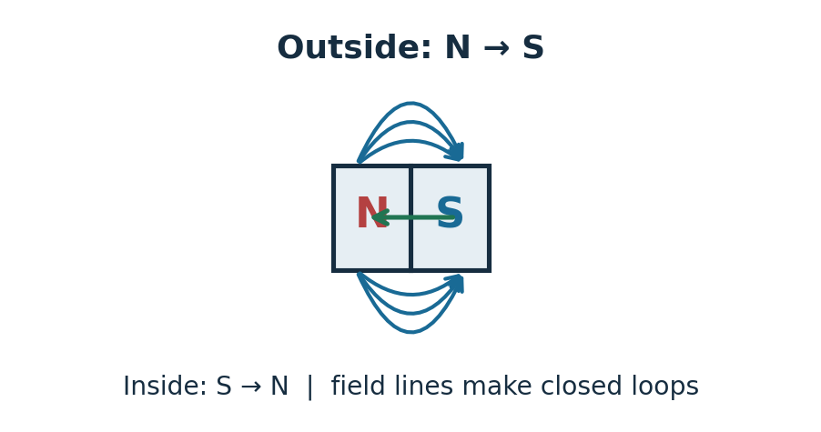
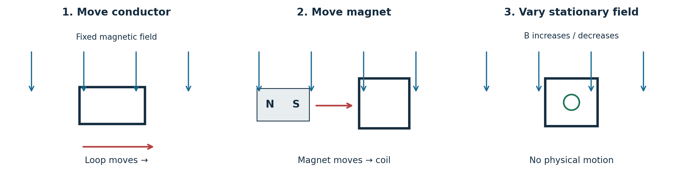
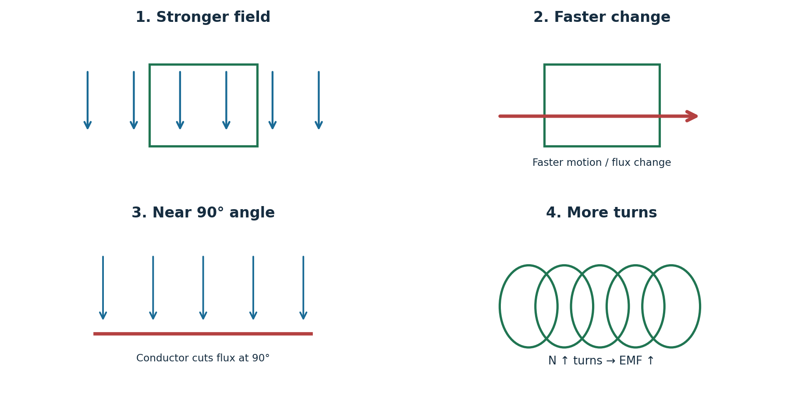
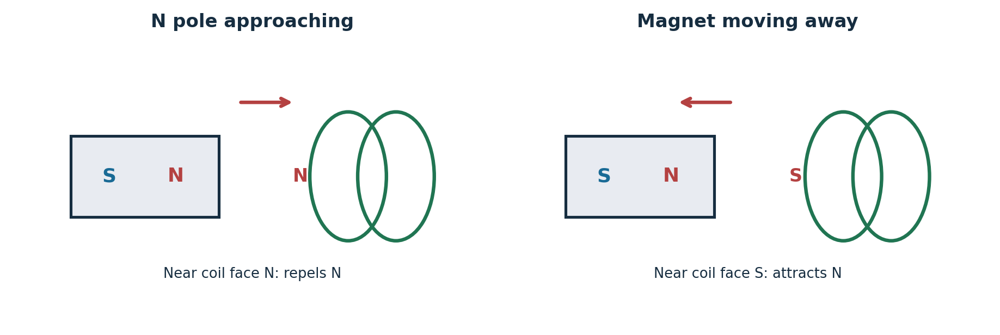
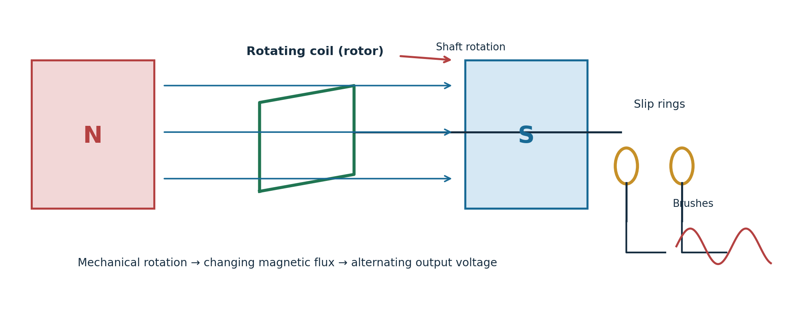
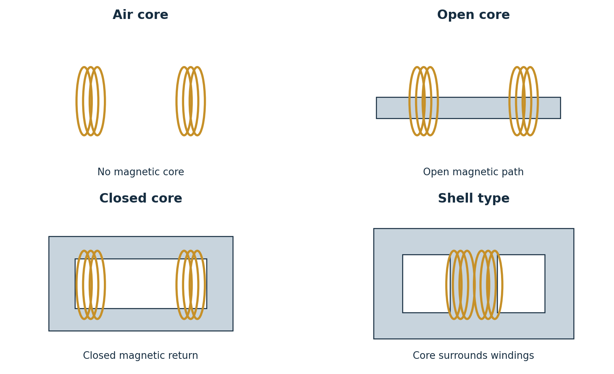

# Magnetism and Electromagnetism (84)

**RAD145 Physics Journal — concise copy-by-hand edition**  
Instructor outline order is preserved. Figures are simple models to copy or print. Sources: Magnetism & Electromagnetism Lectures 1–3.

## A. Magnetism

### 1. Definitions – (6)

**a) Magnet.** An object with aligned magnetic domains that produces a magnetic field and has north and south poles. A magnetic field is shown by lines of flux. (Lecture 1, slides 23–25)

**b) Orbital Magnetic Moment.** Magnetism associated with an electron's motion around the nucleus; the lecture depicts a field perpendicular to the orbit. (L1, 19, 21)

**c) Spin Magnetic Moment.** Magnetism associated with the electron's intrinsic spin. Along with orbital moments, it contributes to an atom's magnetic behavior. (L1, 19–20)

**d) Magnetic Dipole/Domain.** A dipole has north and south magnetic poles. A domain is a region containing many atomic magnetic moments aligned in the same general direction. Aligned domains strengthen a magnet. (L1, 22–23)

**e) Magnetic Permeability.** How easily a material supports a magnetic field or becomes magnetized; the lecture asks, “How easily can it become magnetic?” (L2, 2)

**f) Magnetic Retentivity.** A material's ability to retain magnetization after the magnetizing force is removed. (L2, 2)

### 2. Magnet Types and Materials, and Magnetic Laws (14)

**a) 3 Types of Magnets (description with examples)**

1. **Natural:** Found in nature; examples **lodestone (magnetite)** and **Earth**. (L1, 30–31)
2. **Artificial Permanent:** A manufactured magnet whose aligned domains remain magnetized; examples **bar magnet, horseshoe magnet, compass needle**, often using **alnico** alloy. Excess heat or physical trauma can weaken it. (L1, 32)
3. **Electromagnet:** Magnetism made by **electric current** in a coil, often with an iron core. The magnetic field decreases when current stops; examples **x-ray tube detents and relays**. (L1, 33; L2, 14, 16–17)

**b) 4 Classification of Materials based on Magnetic Interaction (description with examples)**

1. **Ferromagnetic:** Strongly magnetized; domains can align. **Iron, cobalt, nickel**. (L2, 3)
2. **Paramagnetic:** **Weakly attracted** to a magnetic field. **Aluminum, platinum**, and some **MRI contrast agents**. (L2, 3)
3. **Diamagnetic:** **Weakly repelled** by a magnetic field. **Bismuth, beryllium, lead, water**. (L2, 4)
4. **Nonmagnetic (classroom category):** Little noticeable attraction or repulsion in ordinary conditions. **Wood, glass, rubber**. (L2, 4)

### 3. Magnetic Laws and Units (12)

**a) 3 Laws of Magnets (list and briefly describe each)**

1. **Law of Attraction and Repulsion:** **Unlike poles attract; like poles repel.** (L1, 15)
2. **Inverse Square Law:** In the instructor's simplified pole model, magnetic force decreases with the **square of separation**: double distance → **¼** the force. (L1, 16)
3. **Law of Magnetic Poles:** Magnets have **both N and S poles**; even a broken magnet makes smaller dipoles, not an isolated pole. (L1, 17)

Magnetic field lines form closed loops: **outside the magnet N → S; inside S → N**. Lines never intersect. (L1, 24–25)

**b) Units (list 3 units with relation to each other)**

1. **Weber (Wb):** Unit of **magnetic flux** (total field through an area).
2. **Tesla (T):** SI unit of **magnetic flux density**, equal to **1 Wb/m²**.
3. **Gauss (G):** Smaller magnetic flux density unit; **1 T = 10,000 G**.

**Relation:** **1 T = 1 Wb/m² = 10,000 G.** (L1, 28)

## B. Electromagnetism

### 1. Definitions (14)

**a) Electromagnet.** A current-carrying solenoid, usually with a **ferromagnetic core** that strengthens its field. (L2, 12–14)

**b) Electromagnetic induction.** Creating voltage (and current if the circuit is closed) by **changing magnetic flux** through a conductor. (L2, 22, 28)

**c) Fleming’s Hand Rules.** **Right hand = generator effect** (motion creates induced current); **left hand = motor effect** (current in a field creates force/motion). Don't confuse these with the right-hand **thumb/grip** rules. (L2, 8–9, 20, 27; rule names clarified)

**d) Right Hand-Thumb Rule.** For a **straight wire**, thumb points with **conventional current** and curling fingers show field direction. For a **solenoid**, curling fingers show current around the turns and thumb points toward its **north pole**. (L2, 9, 13)

**e) Helix.** A spiral **coil of wire**; the lecture uses the term before current is applied. (L2, 11)

**f) Solenoid.** A **coil carrying current**, producing a magnetic field that resembles a bar magnet. (L2, 12)

**g) Mutual Induction.** A **changing current in a primary coil** produces changing flux that induces voltage in a **separate secondary coil**. Basis of transformers. (L3, 9–11)

**h) Self Induction.** A coil's **own changing current** induces voltage in the same coil that opposes that current change. (L3, 12–13)

**i) Inductive reactance.** Opposition an inductor gives to **changing AC current**, measured in **ohms (Ω)**. More frequency or inductance gives more reactance. **Xₗ = 2πfL** (supplemental formula). (L3, 12–13)

**j) Generator.** Converts **mechanical energy into electrical energy** by electromagnetic induction. (L2, 22, 27)

**k) Motor.** Converts **electrical energy into mechanical motion** using magnetic forces. (L2, 20)

**l) Rotor.** The **rotating** part of a motor or generator; in the illustrated AC generator, the rotating coil/armature. (L2, 27, diagram)

**m) Stator.** The **stationary** part that provides or supports the field in a motor or generator. (L2, 27, diagram; terminology clarified)

**n) Transformer.** Uses **mutual induction** between primary and secondary coils to change **AC voltage**; a step-up raises voltage, and a step-down lowers it. (L3, 14–19)

### 2. Electromagnetic Induction (38)

**a) Oersted’s discovery.** In **1820**, Hans Oersted showed that **electric current produces a magnetic field**: a nearby compass needle deflects when current flows in a wire. (L2, 6–7)

**b) Three items necessary to induce a current with a magnet**

1. **Magnetic field**
2. **Electrical conductor / closed circuit**
3. **Relative change in magnetic flux** (motion or changing field)

A changing field induces **voltage**; a **closed path** is needed for sustained current. (L2, 22, 28)

**c) Three methods to create motion to induce a current (description and drawing)**

1. **Move the conductor** through a **stationary magnetic field**.
2. **Move the magnetic field/magnet** past a **stationary conductor**.
3. **Change the strength of a stationary magnetic field** through a conductor (no physical movement required).

All three change **magnetic flux** linked to the circuit. (L2, 23–26)

**d) 4 parts of Faraday’s Law/First Law of Electromagnetism (description and drawing)**

The amount of induced **voltage** (and current when resistance is fixed) increases with:

1. **Magnetic field strength:** stronger field → greater induction.
2. **Speed of relative motion/change:** faster change → greater induction.
3. **Angle:** conductor cutting field lines **closest to 90°** → greatest effect.
4. **Number of turns:** more coil turns → greater induced voltage.

**Core idea:** **Greater rate of change of magnetic flux = greater induced EMF.** (L3, 2–7)

**e) Lenz’s Law/Second Law of Electromagnetism (description and drawing)**

The induced current creates a magnetic field that **opposes the CHANGE in magnetic flux** that produced it. Example: a **north pole approaching a coil** makes the coil's near face **north** (repels the approach). When the magnet moves away, the induced direction reverses to oppose its departure. (L3, 8)

**f) AC generator (parts, description and drawing)**

**Parts:** **N/S magnetic poles (stator), rotating coil/armature (rotor), shaft, two slip rings, brushes, output circuit.**

**Action:** Mechanical motion turns the coil in the magnetic field → changing flux induces voltage. **Slip rings and brushes** maintain electrical contact while the coil rotates; output **alternates direction (AC)** every half turn. (L2, 27)

**g) Transformer core configuration types**

1. **Air core:** Two coils, no ferromagnetic core.
2. **Open core:** Ferromagnetic core without a complete closed return path.
3. **Closed core:** Core forms a closed magnetic path joining windings.
4. **Shell type:** Core surrounds windings; lecture calls it **most common**, with laminated construction in x-ray generators. (L3, 22–24)

**Autotransformer:** One winding with selectable taps; used to set the voltage fed to the step-up transformer. (L3, 25)

**h) Transformer core losses and fixes**

1. **I²R / copper loss:** Current heats winding resistance. **Fix:** Low-resistance, thicker conductors; higher voltage/lower current for long-distance transfer. (L3, 26–27)
2. **Hysteresis / lagging loss:** Repeated core magnetization/demagnetization wastes energy as heat. **Fix:** **Silicon-iron** core material. (L3, 26, 28)
3. **Eddy current loss:** Swirling induced currents in a solid core cause heat. **Fix:** **Thin insulated laminations** in the core. (L3, 26, 29)

**i) Formulas and examples**

**Ideal transformer formulas:**

- **Voltage / turns:** **Vₛ / Vₚ = Nₛ / Nₚ**
- **Current / turns:** **Iₛ / Iₚ = Nₚ / Nₛ**
- **Power (ideal):** **VₚIₚ ≈ VₛIₛ**

**p = primary (input); s = secondary (output); V = volts; I = amps; N = number of turns.** Voltage and current change in opposite directions. Actual transformers lose some power as heat. (L3, 16–19)

**(1) Step Up Transformer (description and 3 examples with change in V, I and number of turns as x)**

**Step-up:** Secondary has **more turns** (Nₛ > Nₚ), so **V increases** and **I decreases**.

- **Example 1 — find secondary voltage x:** Vₚ = 120 V, Nₚ = 100, Nₛ = 500.  **x = Vₛ = 120(500/100) = 600 V.** (Voltage increases 5×.)
- **Example 2 — find secondary current x:** Iₚ = 5 A, Nₚ = 100, Nₛ = 500.  **x = Iₛ = 5(100/500) = 1 A.** (Current decreases 5×.)
- **Example 3 — find secondary turns x:** Vₚ = 120 V, Vₛ = 480 V, Nₚ = 150.  **x = Nₛ = 150(480/120) = 600 turns.** (4× as many turns.)

**(2) Step Down Transformer (description and 3 examples with change in V, I and number of turns as x)**

**Step-down:** Secondary has **fewer turns** (Nₛ < Nₚ), so **V decreases** and **I increases**.

- **Example 1 — find secondary voltage x:** Vₚ = 240 V, Nₚ = 600, Nₛ = 150.  **x = Vₛ = 240(150/600) = 60 V.** (Voltage decreases to ¼.)
- **Example 2 — find secondary current x:** Iₚ = 2 A, Nₚ = 600, Nₛ = 150.  **x = Iₛ = 2(600/150) = 8 A.** (Current increases 4×.)
- **Example 3 — find secondary turns x:** Vₚ = 240 V, Vₛ = 80 V, Nₚ = 300.  **x = Nₛ = 300(80/240) = 100 turns.** (⅓ as many turns.)
