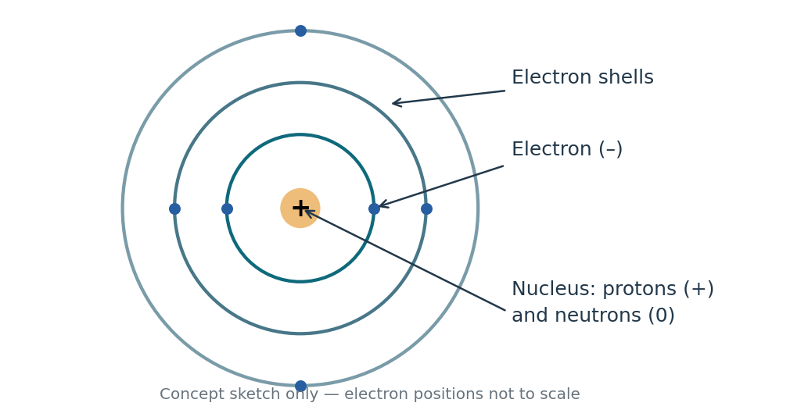
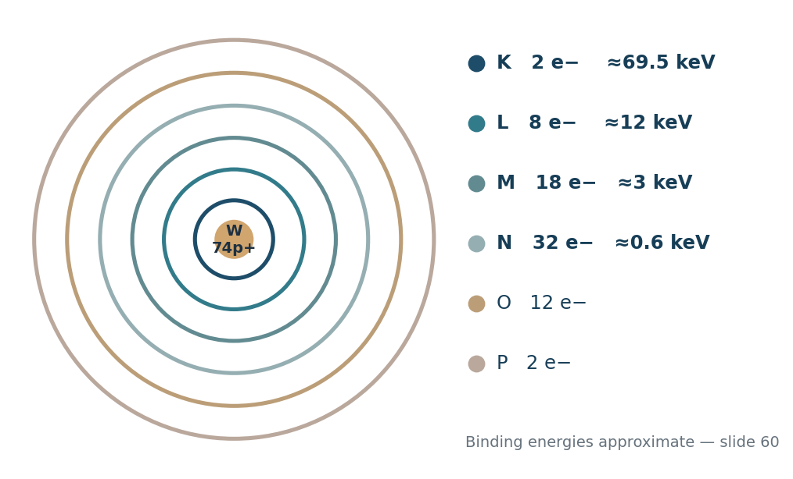
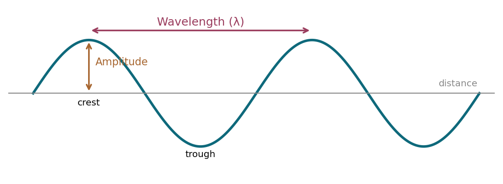

# Structure of Matter

**RAD145 Physics Journal | Revised Study Edition**

Purpose: a complete, concise, instructor-outline-ordered reference journal. The shorter memorization/active-recall guide will be a separate document.

Authority: 01 Structure of Matter.docx (required outline) and Structure of Matter(2).ppt (114 instructor slides). Slide references follow the content. The original handwritten journal is unchanged.

Agreed omission: A.1(c), “Bolded terms in those sections” from unavailable Carlton Chapter 2. Matter, Energy, and course vocabulary are still covered.

Notation: Z = atomic number; A = mass number; n = principal quantum number; e− = electron. Corrections to misleading slide wording are documented at the end.

# A. Matter and Energy Definitions

## 1. Definitions

**a) Matter:** Anything that has mass and takes up space. Matter commonly exists as a solid, liquid, or gas; the state depends on molecular attraction and temperature.

*Instructor slides: 3*

**b) Energy:** The ability to do work. In physics, work = force × distance; force = mass × acceleration. Energy may be stored, moving, or transferred.

*Instructor slides: 51, 55*

## 2. Law of Conservation of Energy

**a) State Law of Conservation of Energy:** Energy cannot be created or destroyed; it changes from one form to another. Total energy remains constant in an isolated system.

*Instructor slides: 57*

**b) Give Radiographic example of application:** An electrical potential accelerates electrons from the cathode toward the anode in the X-ray tube. Their kinetic energy becomes mainly heat and some X-ray photon energy when they strike the target.

*Instructor slides: 58*

# B. Atomic Theory

## 1. Historical Perspective

**a) Greek atom:** The class slide lists four classical elements: air, water, earth, and fire. Context (not stated on that slide): the Greek atomist idea proposed that matter is made of tiny indivisible particles (“atomos”).

*Instructor slides: 4*

**b) Dalton’s atom:** In the early 1800s, Dalton separated elements by their masses. His work helped lead toward the organization of elements in the periodic table.

*Instructor slides: 5*

**c) Thomson atom:** J. J. Thomson discovered the electron and proposed the “plum pudding” model: electrons distributed within a region of positive charge.

*Instructor slides: 6*

**d) Bohr atom:** Bohr’s 1913 model pictured electrons around a central nucleus in distinct shells, like a miniature solar system. Rutherford’s 1911 work had already identified the small, dense, positive nucleus.

*Instructor slides: 7–8*

## 2. Fundamental particles and their properties (use a chart/table)

| Particle | Relative size / mass | Location | Charge |

| --- | --- | --- | --- |

| Proton | ≈1,836 × electron mass | Nucleus | +1 |

| Neutron | ≈1,838 × electron mass | Nucleus | 0 (neutral) |

| Electron | 1 (much smaller) | Outside nucleus, in shells | −1 |

*Instructor slides: 9–10*

## 3. Atomic Structure (describe and draw)

**a) Nucleus:** The very small, dense center of the atom. It contains nearly all the atom’s mass.

*Instructor slides: 9*

**b) Nucleons:** The protons and neutrons within the nucleus.

*Instructor slides: 9–10*

**c) Electrons:** Negatively charged particles located outside the nucleus. They participate in electrical and chemical interactions.

*Instructor slides: 9–10*

**d) Electron shells:** Electron energy levels surrounding the nucleus; the K shell is closest, then L, M, and outward.

*Instructor slides: 24–26*

*Simple atom sketch — nucleus, electrons, and shells*

## 4. Periodic Table

**a) Origin/Historical Information:** Dmitri Mendeleev organized the elements into a periodic table. Each box represents an element.

*Instructor slides: 5, 15*

**b) Chemical symbols:** Each element has a one- or two-letter chemical symbol, such as O for oxygen or W for tungsten. Its atomic number (Z) identifies the element.

*Instructor slides: 14–18*

**c) Rows:** Horizontal rows are periods. In the course shell model, an element’s period corresponds to its number of occupied electron shells.

*Instructor slides: 23*

**d) Columns:** Vertical columns are groups. For main-group elements, members of a group have similar numbers of outer (valence) electrons.

*Instructor slides: 23*

## 5. Electron shells/orbital shells

**a) Description:** An orbital is the region where an electron is likely to be found. Shells group electrons by principal energy level, moving outward K, L, M, N, O, P, Q.

*Instructor slides: 24–26*

**b) Principal quantum number formula:** The maximum number of electrons in a shell in this introductory model is 2n², where n = 1 for K, n = 2 for L, etc.

*Instructor slides: 24, 26*

**Maximum shell capacity = 2n²**

**c) Table of shells/orbitals through P shell:** Use the principal quantum number for each shell:

*Instructor slides: 26*

| Shell | n | Maximum electrons (2n²) |

| --- | --- | --- |

| K | 1 | 2 |

| L | 2 | 8 |

| M | 3 | 18 |

| N | 4 | 32 |

| O | 5 | 50 |

| P | 6 | 72 |

**d) Octet Rule:** In the introductory model, atoms are generally most stable with eight electrons in their outermost shell. Some elements begin filling a new shell before an inner shell reaches its maximum capacity. The “eight” rule has exceptions.

*Instructor slides: 27*

**e) Number of valence electrons:** Valence electrons are those in the outermost occupied shell. Example from the slides: bromine has 7 outer-shell electrons.

*Instructor slides: 28, 35*

**f) Valency (and its effect on electrical properties):** Valency describes how an atom tends to give up, gain, or share electrons during bonding. The slides group positive-valence materials as conductors (copper +1, aluminum +3), negative-valence materials as insulators (fluorine −1, selenium −2), and ±4 materials as semiconductors (silicon, germanium). These are introductory patterns; conductivity depends on the material and conditions.

*Instructor slides: 29–33*

**g) Electron binding energy (draw W atom and label binding energy of first 4 shells):** Binding energy (Eb) is the energy required to remove an electron from its shell. Inner electrons are held more tightly. Tungsten (W, Z = 74) has approximately these binding energies in the class diagram: K 69.5 keV; L 12 keV; M 3 keV; N 0.6 keV. 1 keV = 1,000 eV.

*Instructor slides: 25, 60–61*

*Tungsten shell diagram: course-approximate first four binding energies*

**h) Two alterations that have an effect on changing binding energy:** (1) Distance from the nucleus: inner-shell electrons have greater binding energy. (2) Atomic number Z: more protons generally produce a stronger attraction and higher binding energy. Z counts protons, not nucleons.

*Instructor slides: 25, 60*

Class calculation: when a tungsten electron moves from the L shell into a K-shell vacancy, a characteristic X-ray photon can have energy ≈ 69.5 − 12 = 57.5 keV. (Slide 67.)

## 6. Elemental Descriptions

**a) Atomic mass/A#:** Mass number A = protons + neutrons (nucleons). Example: bromine-80 has 35 protons and 45 neutrons, so A = 80.

*Instructor slides: 16, 34*

**b) Atomic number/Z#:** Atomic number Z = number of protons. For a neutral atom, electrons = protons. Changing Z changes the element.

*Instructor slides: 14, 16–18*

**c) amu:** Atomic mass unit, used to express atomic-scale masses. The atomic weight displayed on a periodic table is usually a decimal; mass number A is a whole number for a particular isotope.

*Instructor slides: 14, 16, 18*

**Neutrons = A − Z     |     Neutral electrons = Z**

## 7. Atomic Variations (describe and offer examples)

**a) Ion:** An atom with unequal numbers of protons and electrons. Losing electrons creates a positive ion (cation); gaining electrons creates a negative ion (anion). Example: 8 protons and 7 electrons gives a +1 charge.

*Instructor slides: 36–40*

**b) Isotope:** Atoms of the same element (same Z/protons) with different numbers of neutrons and therefore different mass numbers A. Example: two carbon atoms with 6 protons but 6 versus 8 neutrons (carbon-12 and carbon-14).

*Instructor slides: 36, 42–43; example added for clarity*

**c) Isobar:** Different elements with the same mass number A but different Z. Slide example: sulfur-40 (16 protons, 24 neutrons) and chlorine-40 (17 protons, 23 neutrons).

*Instructor slides: 45*

**d) Isomer:** Nuclei with the same Z and A but different nuclear energy states (arrangements). Example: an excited/metastable nucleus and the lower-energy state of the same nuclide.

*Instructor slides: 46; explanatory example*

**e) Isotone:** Different elements with the same number of neutrons. Slide example: boron-11 (5 protons + 6 neutrons) and carbon-12 (6 protons + 6 neutrons).

*Instructor slides: 44*

## 8. Combination of atoms

**a) Ionic bond:** One atom transfers one or more electrons to another, creating oppositely charged ions that attract one another.

*Instructor slides: 47*

**b) Covalent bond:** Atoms share electrons, helping form stable outer shells.

*Instructor slides: 47, 49*

# C. Energy

## 1. Types of Energy (description and example)

**a) Mechanical (include potential and kinetic):** Energy from position or motion. Potential energy is stored energy (rock at the top of a cliff); kinetic energy is energy of movement (rock falling).

*Instructor slides: 53, 57*

**b) Chemical:** Energy stored in chemical substances/reactions. Example: a battery changes chemical energy into electrical energy.

*Instructor slides: 53*

**c) Heat/Thermal:** Energy associated with particle motion. Example: a toaster converts electrical energy into heat.

*Instructor slides: 54*

**d) Electrical:** Energy associated with electric charges, including moving electrons in a conductor. Example: a bulb converts electrical energy into light and heat.

*Instructor slides: 54*

**e) Nuclear:** Energy associated with changes in the atom’s nucleus. Example: a nuclear power plant converts nuclear energy into electrical energy.

*Instructor slides: 54*

**f) Electromagnetic:** Energy carried by linked electric and magnetic fields; it travels as radiation. Examples: visible light and X-rays. EM radiation can travel in a vacuum.

*Instructor slides: 78*

## 2. Electromagnetic Spectrum

**a) Forms found on the electromagnetic spectrum:** From shorter to longer wavelength: gamma rays, X-rays, ultraviolet, visible light, infrared, microwaves, and radio waves. The instructor mnemonic begins with “cosmic,” but cosmic rays are not a separate electromagnetic-spectrum band.

*Instructor slides: 79–80*

**b) Wave Theory:** Electromagnetic radiation behaves as waves and does not require matter to travel through. Its basic measurements are wavelength, amplitude, frequency, and period.

*Instructor slides: 82–86*

**(1)) Wavelength:** λ (lambda): distance from one crest to the next, or trough to trough. Distance units include meters; the slides use angstroms (Å) for X-ray wavelengths.

*Instructor slides: 88*

**(2)) Amplitude:** Maximum wave displacement from the center (zero) line to a crest or trough.

*Instructor slides: 87*

**(3)) Frequency:** f or ν (nu): number of cycles passing a point per second. Unit: hertz (Hz). 1 kHz = 1,000 Hz; 1 MHz = 1,000,000 Hz.

*Instructor slides: 89*

**(4)) Period:** T: time required for one full cycle, measured in seconds. Example: at 60 Hz, one cycle lasts 1/60 second (about 0.0167 s).

*Instructor slides: 93–94*

**(5)) Relationship between frequency and wavelength:** They are inversely related: if frequency rises, wavelength falls. In a vacuum, c = λf (speed of light ≈ 3 × 10⁸ m/s).

*Instructor slides: 91, 95–96*

*Wave diagram: wavelength measured crest-to-crest; amplitude from center to crest*

**Wave relation: c = λf        Period: T = 1/f**

**c) Particle Theory:** Electromagnetic radiation also travels as discrete packets of energy called photons (quanta).

*Instructor slides: 97*

**(1)) Photon definition:** A photon is a small packet (quantum) of electromagnetic energy.

*Instructor slides: 97*

**(2)) Relationship between photon energy and frequency:** Photon energy and frequency are directly proportional: higher frequency means higher photon energy; doubling frequency doubles photon energy.

*Instructor slides: 97*

## 3. Discovery of X-rays

**a) Short summary of event:** Wilhelm Conrad Röntgen discovered X-rays on November 8, 1895, at the University of Würzburg in Germany. While using a covered cathode-ray tube in a dark room, he noticed fluorescence from a nearby barium-platinocyanide screen. He received the first Nobel Prize in Physics in 1901.

*Instructor slides: 99–102*

**b) 12 Properties of X-rays:** The instructor’s twelve properties are preserved below in concise wording.

*Instructor slides: 103–114*

1. X-rays are invisible, highly penetrating electromagnetic radiation.

2. X-rays are electrically neutral, unaffected by electric or magnetic fields.

3. X-rays may have many energies and wavelengths (polyenergetic/heterogeneous).

4. X-rays produce very small amounts of heat when passing through matter.

5. X-rays travel in straight lines.

6. X-rays travel at the speed of light in a vacuum (3 × 10⁸ m/s).

7. X-rays can ionize matter.

8. X-rays cause certain crystals to fluoresce (emit light).

9. X-rays cannot be focused by an ordinary lens.

10. X-rays affect photographic film.

11. X-rays cause chemical and biological changes through ionization and excitation.

12. X-rays produce secondary and scattered radiation.

## 4. Radioactivity

**a) Definition:** Spontaneous emission of particles or energy by an unstable nucleus as it moves toward a more stable state. Such atoms are radioisotopes.

*Instructor slides: 69*

**b) Beta emission (description and example):** A beta particle is an electron (β−) or positron (β+) emitted from the nucleus. For β− emission, a neutron changes to a proton; atomic number rises by one, mass number stays the same. Instructor example: potassium-40 → calcium-40 + β−.

*Instructor slides: 72–74*

**c) Alpha emission (description and example):** Emission of an alpha particle: two protons plus two neutrons (helium nucleus). Atomic number decreases by two and mass number decreases by four. Example: uranium-235 → thorium-231 + α.

*Instructor slides: 70–71, 74*

**d) Radioactive Decay Law:** During radioactive decay, the amount of undecayed radioactive material (or activity) falls by one-half for each half-life. The formula below expresses the slide’s half-life examples.

*Instructor slides: 75–77*

**Remaining = Original × (1/2)^(time ÷ half-life)**

**e) Example of Radioactive Half Life:** Iodine-131 has an 8-day half-life. Starting at 100 mCi: after 8 days, 50 mCi remains; after 16 days (two half-lives), 25 mCi remains.

*Instructor slides: 76–77*

## 5. Types of Ionizing Radiation

**a) Particulate description and its two main types:** Ionizing radiation made of moving particles with mass. Two main course examples: alpha particles (2 protons + 2 neutrons) and beta particles (electrons or positrons emitted from nuclei).

*Instructor slides: 69–74*

**b) Electromagnetic description and its two main types:** Ionizing radiation carried by high-energy photons, with no mass or electric charge. Two main course examples: X-rays (produced by extranuclear electron interactions) and gamma rays (originating from nuclear processes).

*Instructor slides: 39–40, 78–81*

# Source fidelity and corrections

The entries above follow the order and requirements of the instructor’s journal. Corrections or clarifications below prevent several slide shortcuts or errors from becoming wrong exam concepts.

**Slide 60 — Z versus nucleons:** The slide says “Z# is number of nucleons.” Correction: Z = protons; A = protons + neutrons (nucleons). Slides 16–18 state the correct relationship.

**Slide 51 — energy versus force:** “Energy is the force used to do work” is imprecise. Slide 55 gives the correct definition: energy is the ability to do work. Force and energy are different quantities.

**Slide 27 — octet rule:** The slide says an atom “never” has more than eight electrons in its outer shell. That is an overstatement. Use the octet rule as the course’s introductory stability pattern, not as an absolute law for all elements.

**Slide 39 — where X-rays come from:** The statement that X-rays originate in an electron shell describes characteristic X-rays but omits bremsstrahlung from decelerating electrons at the target. The radiographic X-ray source includes both processes.

**Slide 60 — first-four-shell values:** The tungsten K/L/M/N energies are rounded slide values (≈69.5/12/3/0.6 keV). They are appropriate for this course sketch, not high-precision subshell data.

**Slide 72 — beta− versus beta+:** The neutron-to-proton conversion applies to β− emission. In β+ emission, a proton converts to a neutron. The journal example is specifically β−.

**Slide 79 — cosmic rays:** The instructor mnemonic includes “cosmic” before gamma. Cosmic rays are mostly high-energy particles, so the EM band list begins with gamma rays.

**Slide 81 — excitation versus ionization:** Excitation means moving an electron to a higher energy state without removing it. Ionization means removing or adding an electron, creating an ion. They are not the same event.

**Slides 4, 46 — source limitations:** The Greek atom and a named nuclear-isomer example are not fully specified in the slides; the minimal atomist context and generic isomer example are explanatory additions, not verbatim slide facts.
